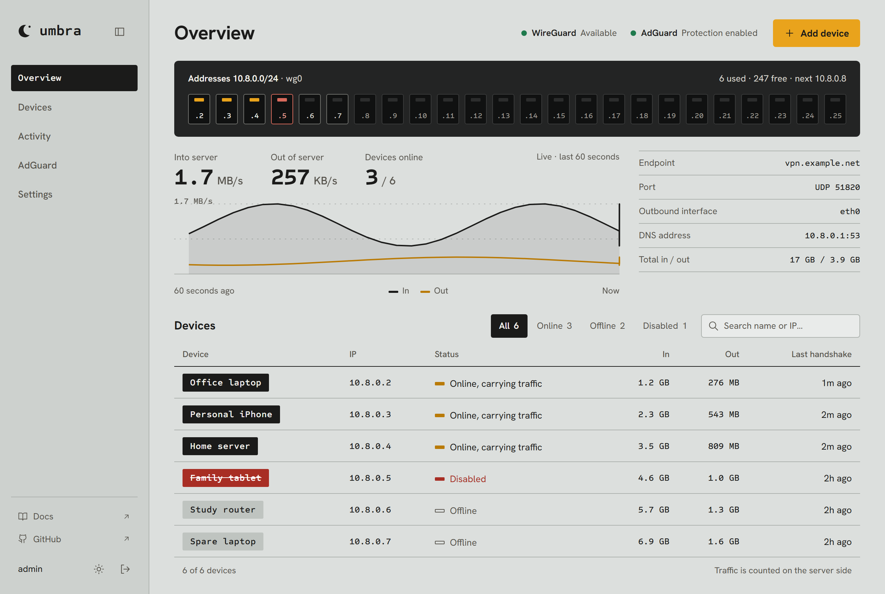
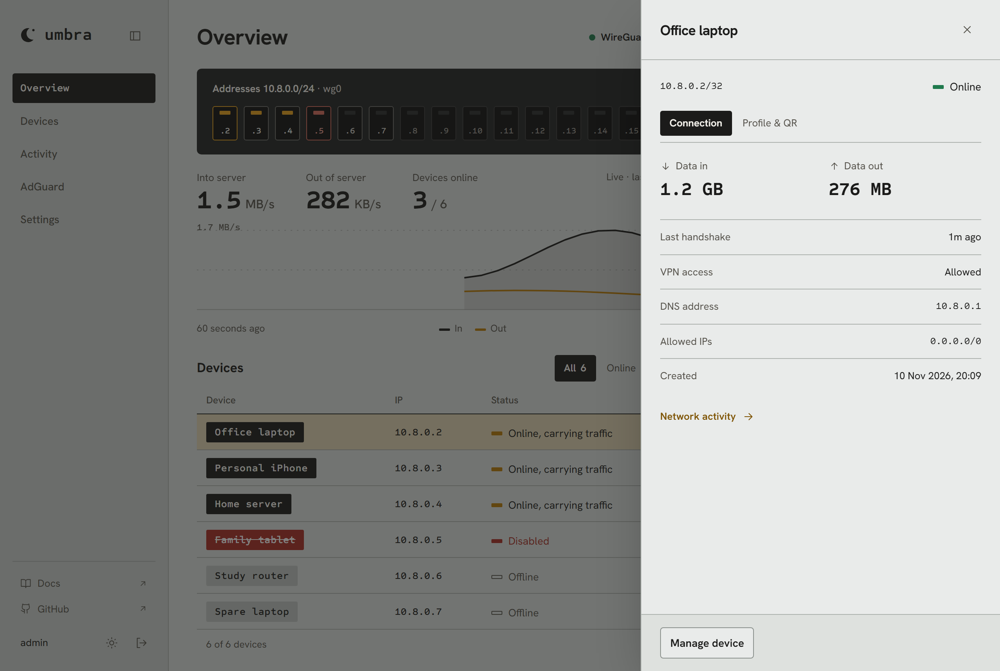
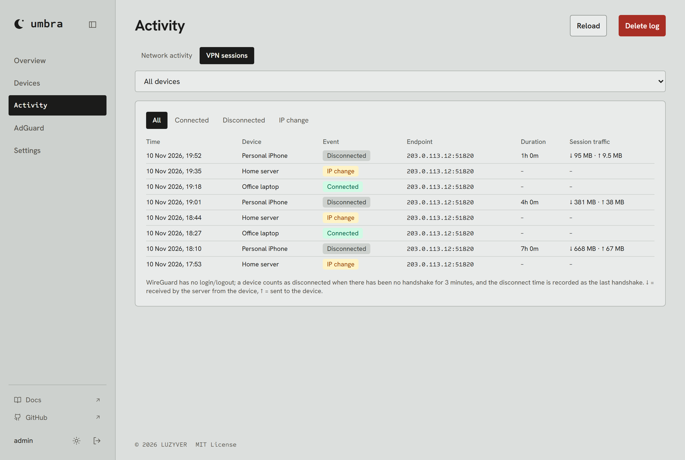
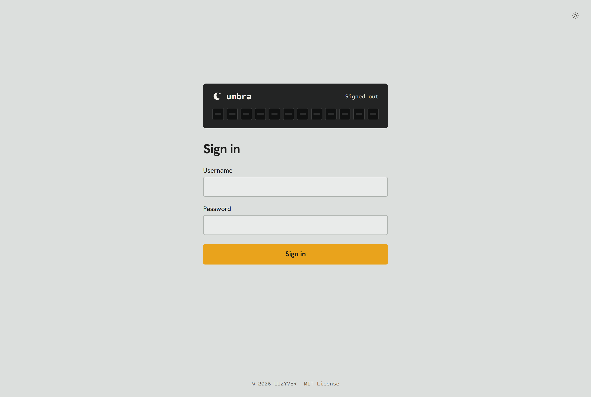
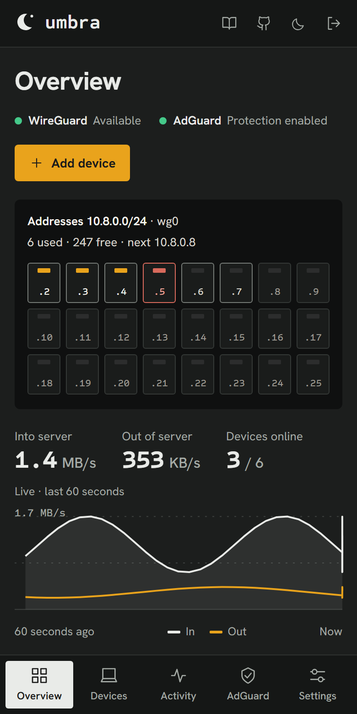
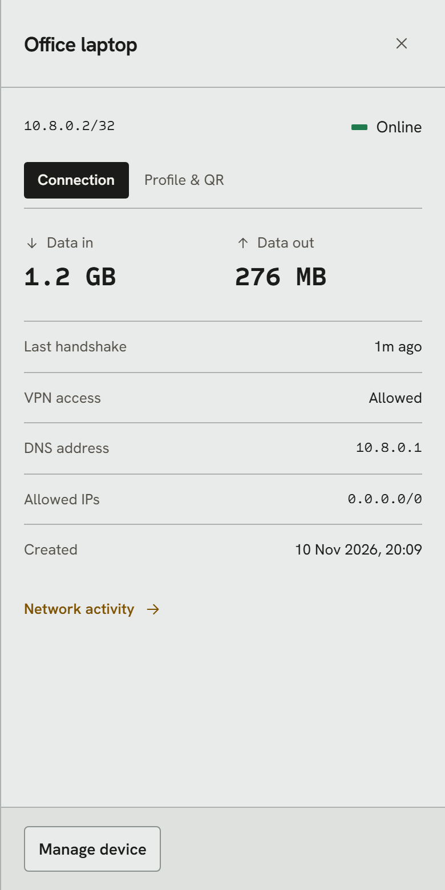
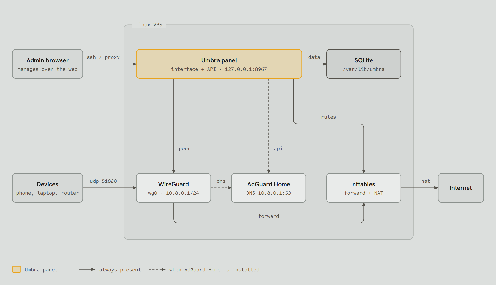
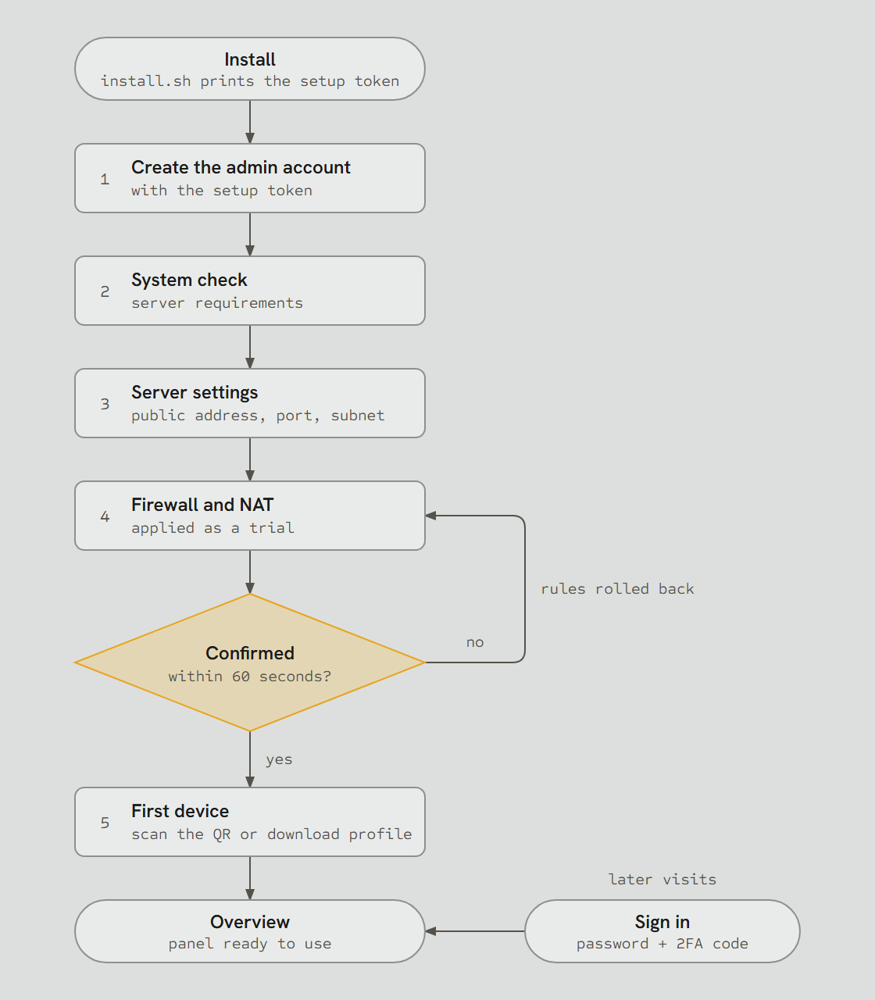

<div align="center">

# Umbra

A web panel for WireGuard and AdGuard Home on a single Linux VPS.

[](https://github.com/luzyver/lzvr-umbra/actions/workflows/release.yml)
[](https://github.com/luzyver/lzvr-umbra/actions/workflows/ci.yml)
[](go.mod)
[](LICENSE)

[Preview](#preview) · [Install](#install-on-a-server) · [How it works](#how-it-works) · [Development](#development)

<picture>
  <source media="(prefers-color-scheme: dark)" srcset="docs/screenshots/overview-dark.png">
  
</picture>

</div>

Umbra is a single Go binary (frontend embedded) that runs a WireGuard server from the browser:
setup wizard, devices with QR codes, live status and traffic, nftables firewall, session log, per-device
network activity, and AdGuard Home installed and managed from the panel. The server needs no Go, Node,
or source code.

## Contents

- [Preview](#preview)
- [Features](#features)
- [How it works](#how-it-works)
- [Requirements](#requirements)
- [Install on a server](#install-on-a-server)
- [Opening the panel](#opening-the-panel)
- [Configuration](#configuration-etcumbraumbraenv)
- [AdGuard Home](#adguard-home)
- [Moving from an existing WireGuard](#moving-from-an-existing-wireguard)
- [Network activity & session log](#network-activity--session-log)
- [Development](#development)
- [Contributing](#contributing)
- [License](#license)

## Preview

| Device details | VPN session log |
|---|---|
|  |  |

| Sign in | Overview on a phone | Device details on a phone |
|---|---|---|
|  |  |  |

All images use sample data and are regenerated with `python web/tests/screenshots.py`
(see [CONTRIBUTING.md](CONTRIBUTING.md#readme-screenshots)).

## Features

- **Setup wizard**: one-time setup token, admin account, endpoint, interface, subnet, and DNS.
- **Devices**: add, disable, download a profile, or scan a QR code from a phone.
- **Import** from `wg0.conf` or a wireguard-ui database, with a preview before saving.
- **Live overview** (SSE): who is online, speed over the last 60 seconds, total data.
- **nftables firewall** with a 60-second trial: new rules roll back automatically unless confirmed.
- **VPN session log**: connected, disconnected, and public IP changes, kept for 90 days.
- **Network activity** per device: current connections (conntrack) and sites visited (AdGuard DNS history).
- **AdGuard Home**: install it and manage filters, DNS, services, clients, and logs from the panel.
- **Secure by default**: listens on `127.0.0.1` only, sessions + CSRF, strict CSP, self-hosted assets.
- **Two-factor authentication** (TOTP) for the admin login, with 8 one-time recovery codes.
- **Works without the kernel module**: if the kernel lacks WireGuard, Umbra uses the `wireguard-go`
  (userspace) implementation built into the binary.
- Light and dark themes, phone friendly.

## How it works

### Architecture

A single `umbra` process serves the interface and the API, stores data in SQLite, and controls WireGuard,
nftables, and AdGuard Home on the same server. The panel listens on `127.0.0.1` only; the WireGuard port
is the only one open to the internet.

<p align="center">
  <picture>
    <source media="(prefers-color-scheme: dark)" srcset="docs/diagrams/architecture-dark.png">
    
  </picture>
</p>

### From install to daily use

<p align="center">
  <picture>
    <source media="(prefers-color-scheme: dark)" srcset="docs/diagrams/flow-dark.png">
    
  </picture>
</p>

## Requirements

- Linux with systemd and root access. Kernel 5.6+ (built-in WireGuard module) is recommended; without it
  Umbra uses `wireguard-go` and only needs `/dev/net/tun` (usually present on KVM/LXC VPSes that allow TUN).
- UDP port 51820 open in the VPS provider's firewall.
- amd64 or arm64. 1 GB of RAM is enough.

If another WireGuard is using `wg0` or port 51820, stop it first.

## Install on a server

On every push to `master`, GitHub Actions builds the frontend and the binaries (amd64 and arm64) and
publishes them to the [`latest`](https://github.com/luzyver/lzvr-umbra/releases/tag/latest) release as
`umbra-linux-<arch>.tar.gz` (+ `.sha256`).

### Option 1: update script (recommended, also used for updates)

`update.sh` fetches the `latest` release, checks its sha256, then runs `install.sh`:

```sh
curl -fsSL https://raw.githubusercontent.com/luzyver/lzvr-umbra/master/deploy/update.sh | sudo sh
```

To **update** later, run the same command. Configuration and data are not overwritten.

<details>
<summary>Private repo or private fork</summary>

The server needs a token to download the release.

1. Create a **fine-grained** token on GitHub (Settings → Developer settings → Fine-grained tokens), limited
   to that repo, with the **Contents: Read-only** permission.
2. Store it on the server:

   ```sh
   sudo install -d -m 0750 /etc/umbra
   sudo sh -c 'umask 077; cat > /etc/umbra/github-token'   # paste the token, Enter, then Ctrl+D
   ```

3. Run (replace `OWNER/REPO`):

   ```sh
   curl -fsSL -H "Authorization: Bearer $(sudo cat /etc/umbra/github-token)" \
     -H "Accept: application/vnd.github.raw" \
     https://api.github.com/repos/OWNER/REPO/contents/deploy/update.sh | sudo UMBRA_REPO=OWNER/REPO sh
   ```

</details>

### Option 2: manual

1. Download `umbra-linux-amd64.tar.gz` and `.sha256` from the `latest` release (`arm64` for ARM VPSes):

   ```sh
   gh release download latest -R luzyver/lzvr-umbra -p 'umbra-linux-amd64.tar.gz*'
   ```

2. Copy them to the server, then:

   ```sh
   sha256sum -c umbra-linux-amd64.tar.gz.sha256
   tar -xzf umbra-linux-amd64.tar.gz
   sudo sh umbra-linux-amd64/install.sh umbra-linux-amd64/umbra
   ```

   Add `--with-adguard` (`install.sh --with-adguard umbra-linux-amd64/umbra`) to have AdGuard Home
   installed as soon as the WireGuard server is set up in the panel.

3. The downloaded files and the extracted folder can be deleted.

### What the installer does

It installs nftables (wireguard-tools is not needed), loads the WireGuard and TUN modules (a module that
fails to load does not stop the installation), enables IP forwarding, allows `wg0` and 51820/udp in UFW
when it is active, creates the `umbra` user, installs the service and a small root helper
(`umbra-helper.path`/`.service`) that installs and removes AdGuard Home, then prints the **setup token**
(also in `/var/lib/umbra/setup-token`). It is safe to run again.

Once installed, Umbra only uses:

| Location | Contents |
|---|---|
| `/usr/local/bin/umbra` | program |
| `/etc/systemd/system/umbra.service` | systemd service |
| `/etc/umbra/umbra.env` | configuration |
| `/var/lib/umbra` | database, setup token, backup `wg0.conf` |

### Check and uninstall

```sh
systemctl status umbra
journalctl -u umbra -f
```

Uninstall: `sudo systemctl disable --now umbra`, then delete `/usr/local/bin/umbra`,
`/etc/systemd/system/umbra.service`, `/etc/umbra`, `/var/lib/umbra`, `/etc/sysctl.d/90-umbra.conf`,
`/etc/modules-load.d/umbra.conf`, and run `sudo nft delete table inet umbra`.

## Opening the panel

By default the panel listens on `127.0.0.1:8967` only. Pick one:

- **SSH tunnel** (easiest): `ssh -L 8967:127.0.0.1:8967 user@server`, then open `http://localhost:8967`.
- **Nginx + HTTPS** (your own domain): set `UMBRA_TRUST_PROXY=true` in `/etc/umbra/umbra.env`,
  `sudo systemctl restart umbra`, then use this example (certificate from certbot):

  ```nginx
  server {
      server_name vpn.example.com;

      # optional: VPN devices only
      # allow 10.8.0.0/24;
      # deny all;

      location /api/events {            # SSE, do not buffer
          proxy_pass http://127.0.0.1:8967;
          proxy_http_version 1.1;
          proxy_set_header Connection "";
          proxy_set_header Host $host;
          proxy_set_header X-Real-IP $remote_addr;
          proxy_set_header X-Forwarded-Proto $scheme;
          proxy_buffering off;
          proxy_read_timeout 1h;
      }

      location / {
          proxy_pass http://127.0.0.1:8967;
          proxy_set_header Host $host;
          proxy_set_header X-Real-IP $remote_addr;
          proxy_set_header X-Forwarded-Proto $scheme;
      }

      listen 443 ssl;
      ssl_certificate     /etc/letsencrypt/live/vpn.example.com/fullchain.pem;
      ssl_certificate_key /etc/letsencrypt/live/vpn.example.com/privkey.pem;
  }
  ```

### First setup

Open the panel, enter the setup token, create the admin account, then fill in the wizard: public endpoint
(e.g. `vpn.example.com:51820`), the server's internet interface (check with `ip route get 1.1.1.1`),
VPN subnet (e.g. `10.8.0.1/24`), and device DNS. Then add a device and scan its QR code.

Turning on **two-factor authentication** right away under Settings → Security is recommended: scan the QR
code with an authenticator app (Google Authenticator, Aegis, 2FAS, etc.), enter the 6-digit code, then save
the 8 recovery codes, which are shown only once. Each recovery code works once, in place of an
authenticator code when signing in or when turning 2FA off (which also asks for the password).

## Configuration (`/etc/umbra/umbra.env`)

| Variable | Default | Meaning |
|---|---|---|
| `UMBRA_LISTEN` | `127.0.0.1:8967` | panel web address |
| `UMBRA_DATA_DIR` | `/var/lib/umbra` | database, setup token, backup `wg0.conf` |
| `UMBRA_SECURE_COOKIE` | `true` | cookie over HTTPS only (localhost still works) |
| `UMBRA_TRUST_PROXY` | `false` | trust `X-Real-IP` from nginx |
| `UMBRA_ADGUARD_URL` | empty | fallback when no AdGuard connection has been saved from the panel |
| `UMBRA_ADGUARD_USER` / `UMBRA_ADGUARD_PASS` | empty | AdGuard Home login (fallback, as above) |
| `UMBRA_WG_BACKEND` | `auto` | `kernel`, `userspace` (`wireguard-go`), or `auto`: kernel when supported, otherwise userspace. The active backend is shown in Settings |
| `UMBRA_ADGUARD_AUTOINSTALL` | `false` | install AdGuard automatically once WireGuard is set up (set by `install.sh --with-adguard`) |

After changing it: `sudo systemctl restart umbra`.

## AdGuard Home

Everything is done from the **AdGuard** menu in the panel:

- **Automatic install**: press *Install AdGuard* (or use `install.sh --with-adguard`). The panel downloads
  AdGuard Home, runs its initial setup, creates an admin account, then configures DNS to listen only on
  the VPN server IP (e.g. `10.8.0.1:53`, not `0.0.0.0`, so it does not become an open resolver), puts the
  web UI on `127.0.0.1:3000`, and changes the default device DNS to that IP.
- **Existing AdGuard**: enter its web address and admin account in the panel. The connection is stored in
  the database and takes effect without a restart; the `UMBRA_ADGUARD_*` values in `umbra.env` are only a
  fallback.
- **Settings**: the tabs are Overview (protection, statistics, safe browsing, parental control, safe
  search), Filters (blocklists, allowlists, custom rules), DNS (upstream, bootstrap), Services (block
  YouTube/TikTok/etc.), Clients (per-device rules), Log (query log), and Connection.
- **Remove**: on the Connection tab, for an AdGuard installed by the panel. Device DNS goes back to the
  server's default DNS.

The panel registers every device in AdGuard as `Name [wg#id]` and sets ad blocking per device.

## Moving from an existing WireGuard

Open **Devices → Import** to move devices from the server's `wg0.conf` or from a wireguard-ui database
(the `db` folder in a ZIP/TAR.GZ, or several device JSON files). Check the preview before saving. Skipped:
devices whose public key or address already exists, addresses outside the server subnet, and invalid keys.

- **`wg0.conf`**: tick "Use the server key and port from the source" so existing profiles on the devices
  keep working unchanged. The server file does not contain device private keys, so their profile/QR code
  cannot be downloaded from Umbra; if needed, use **Regenerate keys** and scan the new profile on that device.
- **wireguard-ui**: the backup contains device private keys, so profiles can be downloaded again right
  away. Extra routes (`extra_allowed_ips`) are not imported.

Stop the old WireGuard (`systemctl disable --now wg-quick@wg0`) before Umbra uses the same `wg0` and port.

## Network activity & session log

The **Activity** menu → **Network activity** tab (pick a device) shows what that device is reaching:

- **Current connections**: read from the kernel connection table (conntrack): destination IP/domain,
  service (HTTPS, DNS, SSH, …), state, and data sent/received per connection. It can refresh every
  5 seconds. Byte counts need `net.netfilter.nf_conntrack_acct=1` (set by `install.sh`).
- **Sites visited (DNS history)**: the AdGuard query log for the device IP: which domains, blocked or not,
  plus the most frequent domains. Needs AdGuard running and the device using AdGuard DNS (the ad blocking
  option).

Only metadata is visible (domain, IP, port, amount of data); page contents cannot be seen because HTTPS
is encrypted.

The **VPN sessions** tab shows when a device connected, disconnected, and changed public IP (e.g. moving
from Wi-Fi to mobile data), with the endpoint, session duration, and session traffic. WireGuard has no
login/logout, so the panel checks handshakes about every 15 seconds: a device counts as disconnected
after 3 minutes without a handshake. The log is stored in the database and deleted automatically after
90 days; it can be filtered by device/event type and cleared manually.

## Development

Needs Go 1.26+ and Node 22+. Windows and macOS work too, because WireGuard and the firewall can be faked.

```sh
# terminal 1: backend with fake WireGuard & firewall (make dev)
UMBRA_DEV=1 UMBRA_FAKE_WG=1 UMBRA_FAKE_FIREWALL=1 go run ./cmd/umbra
# terminal 2: frontend with hot reload (proxies /api to :8967)
cd web && npm ci && npm run dev
```

The setup token is printed in the log and saved in `./data/setup-token`.

| Command | What it does |
|---|---|
| `make build` | build the frontend, then the Linux binary (`GOARCH=arm64 make build` for ARM) |
| `make check` | type-check the frontend (svelte-check) |
| `make test` | `go test` and the frontend tests |
| `make vet` | `go vet` |

Manual build without `make`:

```sh
cd web && npm ci && npm run build && cd ..        # output in internal/ui/dist
GOOS=linux GOARCH=amd64 CGO_ENABLED=0 go build -trimpath -ldflags "-s -w" -o deploy/umbra ./cmd/umbra
```

### Layout

```
cmd/umbra            main program
internal/api         HTTP API, sessions, CSRF, CSP
internal/auth        argon2id, session tokens, login rate limit, TOTP, recovery codes
internal/config      reads the UMBRA_* settings
internal/helper      root helper that installs/removes AdGuard
internal/wg          WireGuard: kernel (wgctrl), userspace (wireguard-go), fake for dev
internal/firewall    nftables + 60-second trial
internal/importer    reads wg0.conf and wireguard-ui databases
internal/adguard     AdGuard Home REST client
internal/conntrack   active connections per device
internal/store       SQLite (modernc, no CGO)
internal/system      system check for the wizard
internal/ui          built frontend (go:embed)
web/                 SvelteKit (Svelte 5, Tailwind 4)
deploy/              install.sh, update.sh, systemd service, env file
docs/screenshots     screenshots for the README
docs/diagrams        README diagrams (HTML source + PNG)
```

SvelteKit 3 note: the `$lib` alias is gone; use `#lib/...` (set under `imports` in `web/package.json`).

## Contributing

Issues and pull requests are welcome. Read [CONTRIBUTING.md](CONTRIBUTING.md) and the
[code of conduct](CODE_OF_CONDUCT.md) first. Report vulnerabilities privately as described in
[SECURITY.md](SECURITY.md). Changes are listed in [CHANGELOG.md](CHANGELOG.md).

## License

[MIT](LICENSE) © 2026 𝙻𝚄𝚉𝚈𝚅𝙴𝚁. The Hanken Grotesk and Sometype Mono fonts are under the SIL Open Font License ([Hanken Grotesk](web/static/fonts/OFL-HankenGrotesk.txt), [Sometype Mono](web/static/fonts/OFL-SometypeMono.txt)).
WireGuard is a registered trademark of Jason A. Donenfeld; Umbra is not affiliated with the WireGuard project
or with AdGuard.
